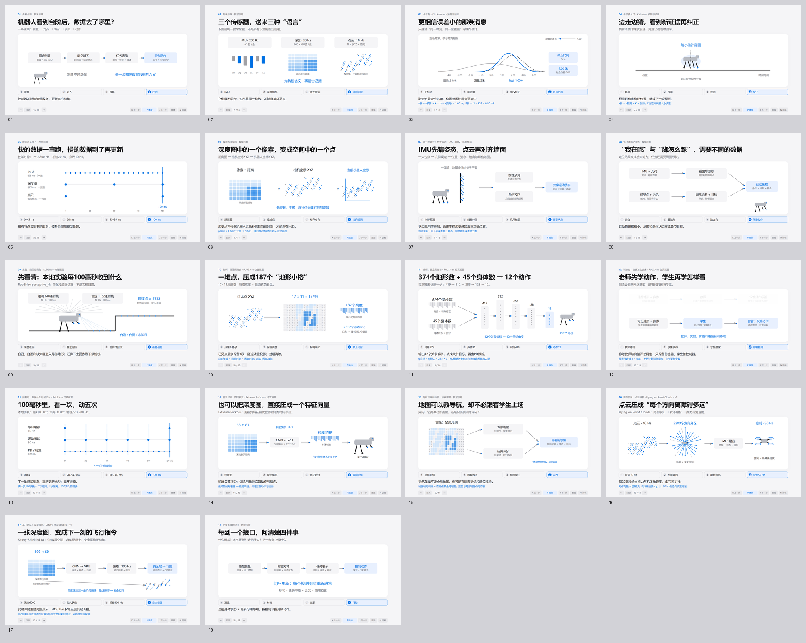

# DF4robot · 数据怎样变成动作

**18页中文动态科普：从卡尔曼融合，到四足高台与无人机导航的数据通路。** 更新：2026-10-19。

演讲围绕四个问题：什么形状的数据、多久更新、途中变成什么、什么时候进入动作控制。公式配合动图、代入数字和符号解释；论文提供具体案例与可点击来源。



## 打开演示

下载仓库，双击 [deck/deck.html](deck/deck.html)，用Chrome或Edge打开。全部图形、CSS和JavaScript均已内联，断网可播放；GitHub代码页不直接运行HTML。

- `← →` / 空格：翻页；数字：跳页；`G`：目录；`F`：全屏。
- `P`：播放/暂停；`J / K`：下一步/上一步；`R`：重播当前页。
- 每页四步，自动播放一轮后停住。可以点击任意步骤，定格讲解。
- `N`：讲稿与来源。第3页拖动测量方差，观察卡尔曼权重与结果变化。
- 系统设置减少动态效果时，默认暂停，可手动播放。

## 讲解路径

| 页 | 主题 | 观众看到的变化 |
|---|---|---|
| 1–2 | 总通路与传感器 | 6轴数据、距离图、XYZ点各自是什么 |
| 3–5 | 卡尔曼与异步 | 权重、误差范围、预测校正、不同频率更新 |
| 6–8 | 对齐与状态融合 | 像素→XYZ、点面误差→状态、定位与运控分工 |
| 9–13 | 四足爬高台 | 射线→局部格→419维输入→12关节动作；训练和控制时钟 |
| 14 | Extreme Parkour | 深度→CNN/GRU→视觉特征→关节命令，10/50Hz与延迟 |
| 15–17 | 地图训练与高飞团队无地图导航 | 教师/奖励的地图、方向距离、深度特征与飞控安全层 |
| 18 | 收束 | 数据形状、更新节拍、含义和使用位置 |

教学配置、本地仿真和论文设置分开标注。相机新帧率不等于策略频率；双传感器输入不代表已证明双传感器收益。案例图是原创机制示意，未声称新实机验证。

## 深入阅读

[逐页讲稿](deck/讲稿.md) · [本版数字与来源核查](research/科普版数据口径.md) · [高台归档接口](research/任务数据流核查.md) · [四足与无人机论文清单](research/视觉四足与无人机无地图导航_2026-10-17.md)

原技术综述、53项论文索引与检索记录仍保留在 `research/`。前一版70页演示可从 [ca5a94f](https://github.com/YuTaoV5/DF4robot/tree/ca5a94f) 查看；旧审阅与页码说明属于历史版本。

## 修改和检查

```powershell
python build_deck.py
node deck/verify_render.cjs
python deck/make_contact.py
```

演示本身不需要安装依赖。构建仅需要Python标准库；渲染检查需要Node.js、Playwright与Chrome；拼接预览需要Pillow。Playwright不在默认位置时设置 `NODE_PATH`；Chrome不在默认位置时设置 `CHROME`。

内容源为 `beginner_deck.py`，图形与公式动画为 `deck/beginner.js`，样式为 `deck/beginner.css`；构建后只有一个 `deck.html`，可单独打开。`deck/validation.json`记录18页、72个阶段的布局、动效和交互检查结果。
